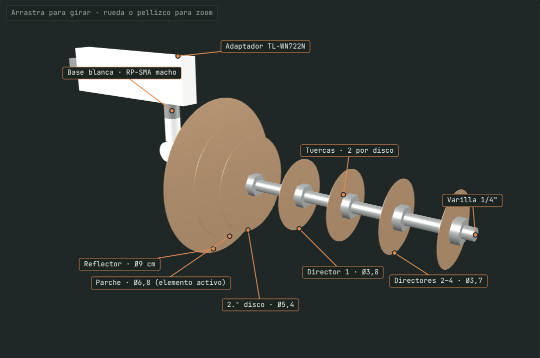
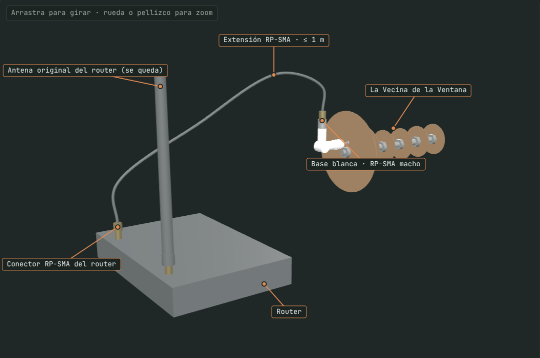

# Pu-36

Antena WiFi casera direccional para 2,4 GHz, hecha con discos de lámina de cobre sobre una varilla roscada. Es una Yagi-Uda de discos: un reflector, un elemento activo (el parche) y cinco discos parásitos que concentran la señal hacia el frente.

**Modelo 3D interactivo:** https://camilomutis.github.io/Pu-36/
(versión conectada al router: https://camilomutis.github.io/Pu-36/#version-2)

| Versión 1 · adaptador USB | Versión 2 · router |
|---|---|
|  |  |

## Cómo nació

Pu-36 es el proyecto del Grupo 2 para el curso de Redes (Universidad, semestre 2026-2). El encargo era construir una antena casera con materiales reciclados o de bajo costo y demostrar con mediciones que funciona.

En la formulación del proyecto la antena se llamó *La Vecina de la Ventana*: la idea era ponerla junto a una ventana y apuntarla hacia un router lejano, para captar señales débiles que la antena que traen los adaptadores no alcanza.

El diseño se tomó del video de KREOSAN sobre un "cañón WiFi" casero (ver [referencias](docs/referencias.md)). De ese video salen las medidas de los discos y las distancias entre ellos.

## Propósito

1. **Construir** una antena direccional de 2,4 GHz (bandas WiFi 802.11 b/g/n) con lámina de cobre, varilla, tuercas y el cable de una antena reciclada.
2. **Medir** si capta mejor que una antena comercial. Se compara contra la antena original de un adaptador USB o de un router: misma red, mismo equipo, mismo lugar.
3. **Demostrar que es direccional**: al girarla de a 45° la señal debe cambiar mucho. Al frente debe ganar y hacia atrás debe perder.

La antena se considera funcional si apuntando al router da un RSSI más cercano a cero que la antena original, sobre todo a mayor distancia.

## Por qué se llama Pu-36

El nombre viene de Marvin el Marciano, el personaje de los Looney Tunes. En los dibujos, Marvin carga un artefacto alienígena con ese nombre, que el grupo recordaba como su pistola. La antena se parece a ese arma de caricatura: un tubo con discos que "dispara" la señal en una sola dirección. Por eso, al publicar el proyecto, *La Vecina de la Ventana* pasó a llamarse **Pu-36**.

## Contenido del repositorio

```
Pu-36/
├── index.html              Modelo 3D interactivo (GitHub Pages)
├── README.md               Este archivo
├── docs/
│   ├── diseno.md           Medidas, materiales y cómo se conecta
│   ├── montaje.md          Paso a paso del armado
│   ├── metodo-de-prueba.md Protocolo de medición
│   ├── referencias.md      Fuentes del diseño
│   └── img/                Capturas del modelo
├── pruebas/
│   ├── README.md           Cómo registrar una prueba
│   ├── plantilla_mediciones.csv
│   └── 2026-11-19_cable-pelado-vs-antena-original/
└── herramientas/
    └── medir.py            Script para medir la señal con un adaptador USB (Linux)
```

## Estado

| Etapa | Estado |
|---|---|
| Diseño y medidas | Listo, comparado con el plano del video |
| Modelo 3D | Listo, con montaje paso a paso y dos versiones de conexión |
| Cable de alimentación | Pelado y alargado con alambre de cobre |
| Corte de discos | Pendiente |
| Montaje | Pendiente |
| Prueba de referencia (cable pelado contra antena original) | Hecha el 19/11/2026 |
| Pruebas de distancia y direccionalidad | Pendientes |

Pendiente de confirmar con el docente: para qué es el "cable número 10 tipo alambre" y qué router se usará en el ensayo.
